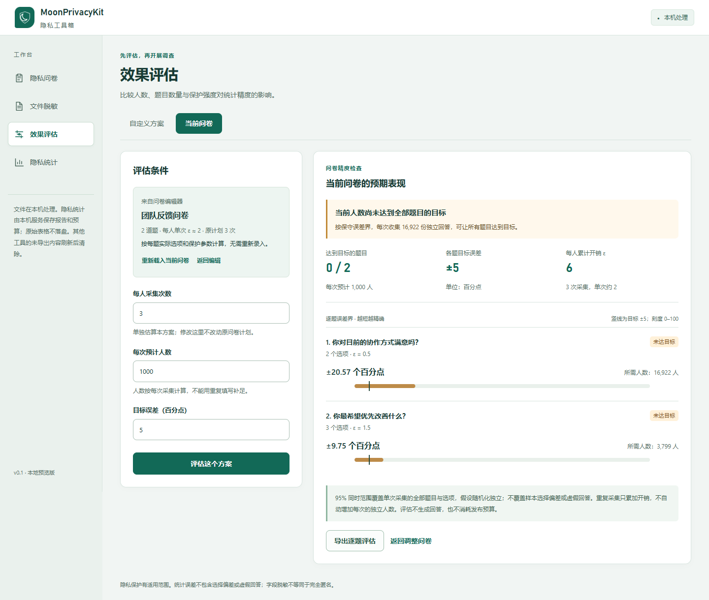

# MoonPrivacyKit · 隐私工具箱

[](https://github.com/TingxuanHan/MoonPrivacyKit/actions/workflows/ci.yml)

用 MoonBit 构建的隐私工具库与中文本地工作台，当前支持隐私问卷、真实数据字段处理、效果评估和带预算管理的隐私统计。长期持续开发更多实用工具，以一致的操作和配置方式帮助用户按需求选用、组合与切换隐私保护方案。



## 现在可以做什么

| 任务 | 首版已实现 |
| --- | --- |
| 隐私问卷 | 团队／课程／服务场景模板、配置复用、参与说明、重复采集开销提示；本地保护回答、导出响应、配置指纹、重复文件去重、汇总比例与误差范围 |
| 文件脱敏 | CSV／JSON 显式字段删除与遮盖、年龄分段、日期保留到月／年、预览、导出、只含数量的处理记录、CSV 公式文本化选项 |
| 效果评估 | 直接载入当前问卷与采集计划，按各题实际选项数和 ε 展示误差、所需人数与累计开销；支持统一参数比较、配置指纹与评估导出 |
| 中心化隐私统计核心 | 按人限制贡献的计数与预设类别直方图、整数噪声、安全随机适配、95% 同时误差界 |
| 发布预算与结果复用 | 本地持久账本、精确预算累计、超预算拒绝、同一请求结果复用、并发与中断恢复；工作台、Node.js 和命令行可用 |
| 真实表格统计发布 | CSV／JSON 人员标识与类别映射、严格输入校验、通过账本发布；工作台提供项目选择、预算展示、图表、历史及重复下载 |
| 统计配置复用 | 人数／类别分布起步模板、当前配置导出、模板导入预览、字段与记录兼容性检查；工作台与命令行使用同一格式 |
| 字段配置与工具衔接 | 保存每列处理规则、检查新增／缺失字段；将处理后的副本转入统计，人员标识须保持原样，年龄段和月份／年份可作类别 |
| 可读报告 | 问卷汇总、逐题／统一参数评估和隐私统计导出离线 HTML，附参数、误差与保护条件；支持打印，重复导出复用已有结果 |
| 开发集成 | MoonBit 类型化接口、JSON 调用接口、Web Crypto 安全随机适配器、命令行、模拟与持续集成 |

这是 **v0.1 本地原型**。首期通过文件交换收集回答；在线问卷托管、身份与网络元数据隔离、全局重复参与限制、自动敏感信息识别均未实现。

## 快速运行

准备 [MoonBit 稳定版工具链](https://www.moonbitlang.com/download)（`moon 0.1.20261012`／`moonc v0.10.15` 或更新版本）和 Node.js 22.13.0 或以上版本，确保 `moon`、`node` 在 PATH 中。可用 `moon version --all` 检查；更早的工具链不支持当前 `Int32` 类型名称，需先更新。应用没有第三方 JavaScript 运行时依赖；本地账本使用 Node.js 内置 SQLite。

```sh
npm run build
npm start
```

浏览器打开 **http://127.0.0.1:4173**。Windows 也可以双击仓库内的 `start.cmd`，它会构建并打开工作台。关闭启动终端可停止服务。

问卷、脱敏和效果评估在浏览器内处理。“隐私统计”在发布时将表格发送到 **127.0.0.1 本机服务**，由持久账本保存预算和受保护报告，不保存原始表格，也不发送到外部服务。页面没有第三方统计脚本；浏览器会话存储只保留所选项目和待确认发布编号，刷新后仍需重新选择原文件，已保存报告可从历史恢复。存储位置与恢复说明见[本地统计工作台](docs/LOCAL_WORKBENCH.md)。

## 完整使用示例

- **团队意见调查：**在“隐私问卷 → 创建问卷”展开场景模板，预览“团队反馈”后应用，复核题目、ε 与采集计划，导出配置和参与说明；参与者载入配置、填写并下载受保护回答；组织者用原配置汇总群体估计与误差。课程与服务场景采用同一流程。
- **处理真实数据：**在“文件脱敏”导入 CSV／JSON，选择要删除或遮盖的字段，检查预览后下载结果和处理记录。原文件不被覆盖。
- **设计调查：**在问卷编辑器点击“评估当前问卷”，题目、ε 与采集计划自动带入；输入每次预计人数和目标误差，逐题查看误差、所需人数与达标状态。返回修改问卷后，旧评估失效，重新载入即可比较新的方案。
- **发布隐私统计：**在“隐私统计”创建统计项目和总预算，导入表格并选择人员标识列；选择计数或预设类别分布，设置每人贡献上限和本次 ε，生成报告。图表展示受保护计数与误差范围，历史报告可反复查看、下载，不再次消耗预算。

命令行对应流程见 [使用说明](docs/GETTING_STARTED.md)，可直接使用 `examples/` 中的虚构数据。

结果旁的“下载可读报告（HTML）”可保存一份带说明的离线文档，用浏览器打开后即可阅读、打印或保存为 PDF。JSON 继续用于程序处理；已有统计报告从历史打开后也可导出，两种格式都不产生新的发布开销。命令行和 SDK 采用同一转换实现，详见[可读报告导出](docs/READABLE_REPORTS.md)。

问卷题目与采集计划可保存为模板，下次先预览、再确认替换；每次应用建立新问卷，不混用旧回答。参与说明包含对应配置的指纹和开销说明。填写过程中更换配置须确认，取消后仍可继续填写或下载原回答。详见[问卷模板与参与说明](docs/SURVEY_TEMPLATES.md)。

[逐题精度评估](docs/SURVEY_ASSESSMENT.md)复用当前问卷的实际配置，不要求各题参数相同。误差范围同时覆盖单次采集的全部题目与选项；重复采集只累加计划开销。评估不生成回答、不消耗发布预算，导出报告不含个人回答。

重复进行相同口径的统计时，可在工作台保存配置模板，再用于兼容的 CSV／JSON；也可通过 `check-template` 检查，使用 `publish-template` 从命令行发布。模板不带原始数据、账本或发布身份，不重置预算，详见[统计配置模板](docs/STATISTICS_TEMPLATES.md)。

重复处理相同结构的文件时，可导出字段配置，下次检查并应用。处理结果可直接转入“隐私统计”，省去中间下载与上传；被遮盖、删除或因 CSV 公式文本化而改写的列不会列入可选统计字段。详见[字段配置与统计衔接](docs/FIELD_WORKFLOWS.md)。

中心化统计核心的虚构数据示例为 `node examples/central.mjs`，需先构建。带预算管理的完整命令行示例见[发布账本](docs/RELEASE_LEDGER.md)。也可用 `publish-table` 从真实 CSV／JSON 表中指定人员标识与类别字段，生成受保护报告，详见[表格统计流程](docs/TABLE_STATISTICS.md)。工作台与命令行复用同一核心和账本实现。

## 开发与验证

```sh
# 编译检查、Wasm 与 JavaScript 目标测试、命令行与统计测试
npm run verify

# 安装浏览器测试依赖并验证完整界面流程
npm ci --ignore-scripts
npx playwright install chromium
npm run test:ui

# 可复现的虚构数据评估；先创建 reports 目录，输出文件必须不存在
node scripts/evaluate.mjs reports/evaluation.json
```

本地验证记录及限制见 [VALIDATION.md](docs/VALIDATION.md)。GitHub Actions 在推送与拉取请求时运行核心、文件操作和浏览器测试。开发时每完成一个可验证的功能节点再提交，修复也保留独立记录。

## 实现结构

- 根目录 `.mbt`：随机响应、中心化隐私统计、比例估计、方案评估、问卷模型、CSV／JSON 脱敏、统计字段映射与输入校验。
- `bridge/`：导出 MoonBit JSON 接口，编译成 `dist/core.js`。
- `runtime/`：安全随机数、配置指纹、发布账本与宿主适配。
- `web/`、`cli/`：中文工作台与文件操作入口。
- `tests/`、`scripts/`：端到端测试、构建、评估与本地服务。

MoonBit 核心可面向 Wasm 和 JavaScript 编译；当前工作台运行的是 **MoonBit 编译得到的 JavaScript**。尚未提供浏览器 Wasm 加载器。

## 保护范围

随机响应保护已声明选项中的回答内容，不隐藏参与事实、文件传送身份、IP 或设备信息。它依赖可信客户端与安全随机源；重复生成回答会产生额外隐私开销，重试应复用同一文件。小样本不一定能产生有用的统计结论。

脱敏由使用者明确选字段。未选中的字段和字段之间的关联仍可能泄露信息，不承诺完全匿名。详细说明见 [隐私模型](docs/PRIVACY_MODEL.md) 与 [机制及误差分析](docs/MECHANISM.md)。

中心化统计依赖可信数据持有者，以及正确、稳定的人员标识；保护统计输出，不隐藏持有者已知的明细。通过账本发布时，新请求累计消耗 ε，同一请求复用原结果。直接调用无状态核心不会自动记账；删除或回滚本地账本也不能被视为重置隐私开销。

## 路线与来源

项目长期目标是持续扩展、统一易用的隐私工具平台。后续将提供更多字段处理与统计任务、样本重叠核对、联合分析和加密数据委托计算等工具；通过任务向导、可复用配置及流程模板，让用户在兼容条件下衔接工具，按需求切换方案，减少重复学习与配置。

中心化差分隐私核心、发布账本、真实表格命令行、工作台、统计与字段模板，以及字段处理结果转入统计均已实现。[年龄分段与日期降精度](docs/FIELD_GENERALIZATION.md)已接入模板、预览和后续类别统计；人员标识必须保持原样。[问卷场景模板与参与说明](docs/SURVEY_TEMPLATES.md)已支持三个常见用途和配置复用，[逐题精度评估](docs/SURVEY_ASSESSMENT.md)已直接连接问卷编辑器，[可读报告](docs/READABLE_REPORTS.md)已统一结果交付方式。下一步完善按任务选择工具的向导，帮助使用者根据数据来源、用途和信任条件进入合适流程。通用流程引擎、方案切换及新增密码计算工具尚未实现。具体交付内容见[开发路线](docs/ROADMAP.md)，共同使用方式和支撑技术见[工具与技术规划](docs/TECHNOLOGY_PLAN.md)，申报正文见 [APPLICATION.md](docs/APPLICATION.md)。

采用 Apache-2.0。随机响应使用公开统计方法，核心实现独立编写，不宣称发明新的隐私算法，也不把整个 MoonBit 隐私领域视为生态空白。[参考资料与相邻项目](docs/REFERENCES.md) 说明了项目范围与许可来源。
